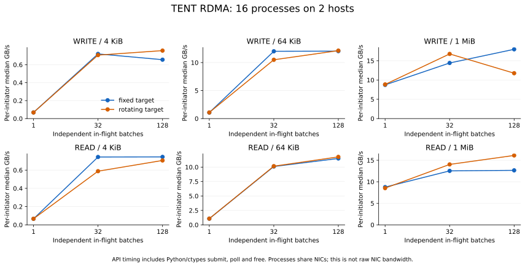

# Mooncake TENT Ascend 异步进展与资源生命周期

## 研究问题

Mooncake TENT 的 Ascend Direct 后端限制最多 100 个在途传输组。旧实现依赖调用者查询状态来推进完成：调用者先连续提交、再统一查询时，第 101 个 Group 可能等待 credit。此前的 Group 即使已经被 Vendor 判定为完成，也不会在提交路径自动归还额度。

本项目回答三个问题：

1. 这个停滞能否在固定输入下复现？
2. 能否在不改变公开 API、不增加后台线程的条件下恢复进展，并保持结果与资源生命周期正确？
3. 修复通过了哪些层次的验证，代价和未验证边界是什么？

代码基线为 `kvcache-ai/Mooncake@5d0636f5d39f9de729a58ea036f98c395dd0b291`。补丁修改 3 个生产文件和 1 个测试文件；生产代码增加 202 行、删除 142 行，测试增加 283 行、删除 2 行，新增 10 个测试场景。

## 故障条件

多个 Request 可以按 `(local_engine, remote, opcode)` 合并为一个 Vendor Group。上限 100 约束的是尚未进入终态的 Group，不是字节数或应用 Request 总数。

旧实现的最小故障序列：

1. 调用者提交 100 个独立 Group，但尚未查询状态。
2. Vendor 已经可以报告部分 Group 完成。
3. 第 101 次提交等待 in-flight credit。
4. 状态查询原本计划在全部提交之后执行。
5. 提交路径不推进完成，额度不能归还，提交最终超时或失败。

`quiesce()` 存在相同依赖：外部消费者不再查询时，已经完成的工作仍可能占用额度。

## 实现

| 问题 | 修改 |
|---|---|
| 饱和提交不推进完成 | 等待 credit 时主动调用 `progressPending()` |
| quiesce 依赖消费者查询 | 排空阶段复用同一完成推进逻辑 |
| credit 与结果消费耦合 | Group 进入终态时归还 credit，结果保留到各 task 消费 |
| Vendor handle 可复用 | 使用单调递增 `group_id` 标识应用结果 |
| pending Batch 可能过早释放 | 未完成时拒绝释放 |
| DMA flag 释放顺序错误 | 先终止并销毁 ACL stream，再释放 host flag |

`progress_mutex_` 串行化 Vendor 提交与结果发布、完成查询和 route 故障处理；等待 credit 时不持有该锁。补丁没有增加公开 API 或后台线程。

## 差分回归

CPU harness 编译真实的 `AscendDirectTransport`、`HixlEngine`、`LocalCopyEngine` 和 `SegmentManager` 源码，并用测试替身提供 ACL/HIXL 外部接口。

| 版本或构建 | 结果 | 支持的结论 |
|---|---:|---|
| 原版生产代码 + 扩展测试 | 33 项中 7 项失败 | 目标缺陷可稳定复现 |
| 修复版 Debug | 34/34 | 功能回归通过 |
| 修复版 Release | 34/34 | 最终生产源码通过回归 |
| ASan + UBSan | 34/34 | 已执行的主机内存路径未报错 |
| TSan | 34/34 | 已执行的主机并发路径未报数据竞争 |

修复版额外运行 8 线程 × 256 Group，共 2,048 次 Vendor 提交和 2,048 次查询，结束时在途额度为 0。

证据：[回归汇总](results/cpu/summary.json)。

## CANN/HIXL 9.1 构建

在 CANN/HIXL 9.1、GCC 11.4、GLIBC 2.35 环境中，完整构建了 `tent_shared` 和 `tent_ascend_direct_transport_test`。测试结果为 34/34 通过，两个产物的动态库依赖均可解析。

这证明源码可以使用真实 CANN/HIXL 9.1 声明和库完成编译链接。它不证明设备执行：单元测试替换了 ACL 函数和 HIXL Vendor，HAL 来自工具包 devlib。

证据：[脱敏构建摘要](results/sdk-cann91/summary.json)。

## 主机控制路径成本

Release 模式下注入立即完成的 Vendor。每个样本执行 10,000 次 `allocate → submit → poll → free`，原版和修复版各 11 个样本。

| 版本 | 单轮中位开销 |
|---|---:|
| 原版 | 1,251 ns |
| 修复版 | 1,313 ns |
| 差值 | +62 ns，约 +5.0% |

这是主机状态管理微基准，不是网络或 HIXL 设备延迟。真实多设备并发下，全局进度锁是否限制吞吐仍未回答。

证据：[全部样本](results/cpu/roundtrip-release.json)。

## TCP 与 RDMA 数据路径

同机 TCP 使用 4 个独立进程完成 36,864 次传输和 12.796875 GiB payload 校验。

两机 RDMA 使用 16 个进程完成：

- 147,456 次传输；
- 51.1875 GiB payload；
- 所有指定范围校验通过；
- 16 个进程正常退出。

图中的吞吐是单发起者完成一轮 API 调用的中位数。计时包含 Python/ctypes、submit、poll 和 free，不包含注册与数据校验。多个进程共享 NIC，因此不能把单发起者中位数相加为同步集群总吞吐。

证据：[TCP 汇总](results/tcp-loopback/summary.json)、[RDMA 汇总](results/rdma16/summary.json)。

这些实验验证测试工具、完整 TENT API 和 TCP/RDMA 后端，没有执行 Ascend 补丁，不能用来宣称 Ascend 性能提升。

## 结论与边界

差分回归支持以下结论：原实现存在可复现的饱和进展和资源生命周期缺陷；补丁在已执行的主机状态机、并发和 sanitizer 路径上修复了这些问题。真实 CANN/HIXL 9.1 编译和链接也已通过。

当前证据尚未回答：

- 真实 NPU 驱动下的 DMA 是否按预期终止；
- 跨机 HIXL 的完成、断连和 handle 回收语义；
- 原版与修复版在真实 Ascend 上的性能差异；
- `progress_mutex_` 在多设备并发下是否成为瓶颈。

因此不能使用“已合并上游”“16 卡 NPU 验证通过”或“Ascend 补丁带来 RDMA 吞吐提升”等表述。
