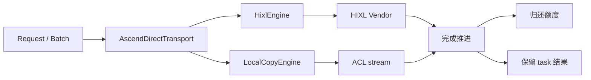
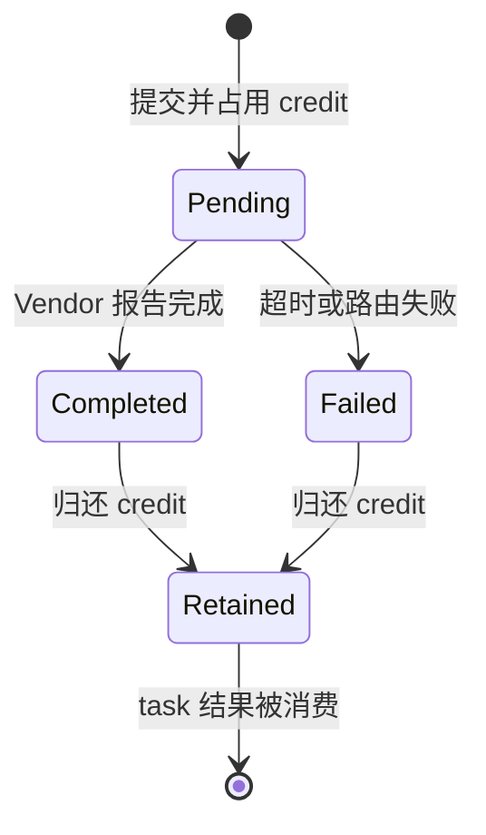

# Mooncake TENT 源码阅读指南

本指南面向需要审查补丁或深入理解异步传输实现的读者。第一次接触 Mooncake、RDMA 或 Ascend HIXL 时，建议先读[入门版源码指南](source-guide-friendly.md)。

代码基线为 Mooncake `5d0636f5d39f9de729a58ea036f98c395dd0b291`。以下路径相对于 `mooncake_network/`。

## 要回答的问题

阅读源码时围绕四个问题展开：

1. TENT 如何把应用 Request 解析成具体 transport 的工作？
2. 为什么“提交成功”和“传输完成”必须分开？
3. 第 101 个 Ascend 传输组为什么会停滞？
4. 完成、结果消费、额度和 DMA 资源应在什么时候回收？

## 最小术语表

| 术语 | 在本文中的含义 |
|---|---|
| Request | 一次 READ/WRITE 的源地址、远端 segment、偏移和长度 |
| Batch | 一组由调用者统一提交和查询的 Request |
| Segment | 可被其他节点定位和访问的一段内存 |
| Transport | RDMA、TCP、SHM、Ascend Direct 等具体传输后端 |
| MR | RDMA Memory Region，设备可访问内存的注册结果 |
| QP | RDMA Queue Pair，承载发送和接收工作请求 |
| CQ | Completion Queue，返回工作完成事件 |
| Vendor handle | HIXL 返回、用于查询底层传输状态的句柄 |
| Group | Ascend 后端按 `(local_engine, remote, opcode)` 合并的 Vendor 请求单元 |
| Credit | 对在途 Group 数量的额度限制 |

## 1. 从公开接口进入

先读[公开 C/C++ 接口](https://github.com/kvcache-ai/Mooncake/blob/5d0636f5d39f9de729a58ea036f98c395dd0b291/mooncake-transfer-engine/tent/include/tent/transfer_engine.h)，再读[C ABI 实现](https://github.com/kvcache-ai/Mooncake/blob/5d0636f5d39f9de729a58ea036f98c395dd0b291/mooncake-transfer-engine/tent/src/transfer_engine_c.cpp)和[核心实现](https://github.com/kvcache-ai/Mooncake/blob/5d0636f5d39f9de729a58ea036f98c395dd0b291/mooncake-transfer-engine/tent/src/runtime/transfer_engine_impl.cpp)。

只跟踪一条最小调用链：

```text
register memory
    ↓
open remote segment
    ↓
allocate batch
    ↓
submit Request
    ↓
query task/batch status
    ↓
free batch and unregister memory
```

注意接口中的两个显式选择：

- `MemoryOptions.transport_type` 决定一段内存注册给哪个 transport；
- `Request.transport_hint` 指定某次请求使用哪个 transport。

本项目在网络测试中显式设置二者，使 RDMA 注册或提交失败直接暴露，而不是静默回退到 TCP。[集成测试](../benchmarks/tent_bench.py)通过完整动态库的公开 C ABI 发起请求，不是另写的传输引擎。

## 2. 内存注册先于数据传输

阅读 `TransferEngineImpl::registerLocalMemory()`，然后进入 [RDMA buffers](https://github.com/kvcache-ai/Mooncake/blob/5d0636f5d39f9de729a58ea036f98c395dd0b291/mooncake-transfer-engine/tent/src/transport/rdma/buffers.cpp)。

RDMA 设备不能安全地访问任意用户指针。注册过程需要确认地址、长度、权限、内存位置和适用的 transport，并建立设备访问所需的 MR：

- `lkey` 授权本地设备访问这段内存；
- `rkey` 授权远端 RDMA 操作访问这段内存；
- `rkey` 不是应用 Request ID。

三个生命周期不能混为一谈：用户 buffer、MR 和在途工作请求。只有确认设备不再访问后，才能注销 MR 或释放 buffer。

进一步检查 `addMemoryBuffer()` 的失败回滚：如果一组 buffer 只注册了前半部分，已经完成的注册和远端 metadata 如何撤销。

## 3. RDMA 路径说明“submit 不等于 complete”

阅读：

- [endpoint.cpp](https://github.com/kvcache-ai/Mooncake/blob/5d0636f5d39f9de729a58ea036f98c395dd0b291/mooncake-transfer-engine/tent/src/transport/rdma/endpoint.cpp)：QP 创建、连接和 `beginDestroyNoLock()`；
- [cq.cpp](https://github.com/kvcache-ai/Mooncake/blob/5d0636f5d39f9de729a58ea036f98c395dd0b291/mooncake-transfer-engine/tent/src/transport/rdma/cq.cpp)：`reserveQuota()` 和 `poll()`。

工作请求 WR 被提交到 QP，设备完成后才在 CQ 中产生完成项。`ibv_post_send()` 成功只表示设备接受请求，不能推出以下结论：

- 数据已经写入远端内存；
- 目标应用已经消费数据；
- 源 buffer 可以立即复用；
- QP、MR 或连接可以立即销毁。

错误路径通常先把 QP 转为错误状态，让在途 WR 产生 flush completion，再逐项回收。`RdmaCQ::poll()` 的容量也必须与实际完成项对应，不能在一次调用后无条件清零。

本项目修复的是 Ascend Direct，不是 RDMA CQ；阅读 RDMA 路径的目的，是建立通用的异步完成和资源回收模型。

## 4. Ascend Direct 的两条执行路径

从 [AscendDirectTransport](https://github.com/kvcache-ai/Mooncake/blob/5d0636f5d39f9de729a58ea036f98c395dd0b291/mooncake-transfer-engine/tent/src/transport/ascend/ascend_direct_transport.cpp) 开始，重点跟踪：

- `submitTransferTasks()`：接收 transport 子批次；
- `resolveRequest()`：解析本地/远端内存和执行引擎；
- `startGroup()`：向 Vendor 提交合并后的组；
- `acquireInflight()`：申请在途额度；
- `progressPending()`：查询并发布完成；
- `getTransferStatus()`：向调用者返回 task 状态。

后端有两条主要路径：



`HixlEngine` 处理需要 HIXL 的传输；同一执行引擎上的本地拷贝可由 `LocalCopyEngine` 和 ACL stream 完成。两者共享上层的 batch 和状态语义，但故障范围和资源不同。

## 5. 用最小序列复现第 101 个组的停滞

多个 Request 可以按 `(local_engine, remote, opcode)` 合并为一个 Vendor Group。上限 100 约束 Group，而不是所有 Request。

旧逻辑：

```text
提交 Group 1..100
    ↓
Vendor 已完成部分 Group
    ↓
提交 Group 101，等待 credit
    ↓
调用者还未进入 getTransferStatus()
    ↓
没有代码推进已完成 Group
    ↓
credit 不归还，等待超时
```

修复后的 `acquireInflight()` 在额度不足时调用 `progressPending()`。如果某个 pending Group 已进入终态，完成逻辑归还额度，第 101 个 Group 就可以继续提交。`quiesce()` 使用同一推进逻辑，避免停机排空依赖外部消费者。

这个设计没有后台线程。正常提交仍是调用者驱动；只有饱和等待、状态查询或 quiesce 等路径推进完成。

## 6. 分离三个生命周期

阅读 `GroupState`、`completeGroup()`、`completePolledTask()` 和 `finishTaskLocked()`。



需要分开的三个时刻是：

1. **Vendor 传输进入终态**：不再占用硬件在途额度。
2. **应用读取 task 结果**：结果必须仍可查询。
3. **batch 和关联资源释放**：所有需要的结果已消费，且设备不再访问内存。

一个 Group 可以包含多个 task。第一个 task 查询时，整个 Group 可能已经完成；此时应归还 Group credit，但其他 task 的结果仍要保留。`remaining` 统计尚未消费的 task，`counted` 防止重复归还额度。

Vendor handle 可能在完成后被复用。如果它同时用作历史结果的 map key，新 Group 会覆盖旧 Group 尚未消费的结果。补丁使用单调递增 `group_id` 标识应用结果，而 Vendor handle 只负责查询底层状态。这与文件描述符复用时需要连接代次的原因相同。

## 7. 锁与故障范围

`progress_mutex_` 串行化以下操作：

- Vendor 提交及 Group 发布；
- pending Group 轮询和终态发布；
- route 故障处理与连接清理。

等待 credit 时不能持有该锁，否则负责推进完成的线程也无法进入。测试覆盖多个线程操作各自的 batch，不保证同一个 batch 的并发修改，也不覆盖并发 shutdown。

远端 HIXL 失败按 `(engine, remote)` 隔离；本地拷贝失败按 ACL stream 隔离。不能因为一个 route 失败就把所有远端或所有本地请求标记为失败。

## 8. DMA completion flag 的释放顺序

阅读 [local_copy_engine.cpp](https://github.com/kvcache-ai/Mooncake/blob/5d0636f5d39f9de729a58ea036f98c395dd0b291/mooncake-transfer-engine/tent/src/transport/ascend/local_copy_engine.cpp) 的 `submit()` 和 `finalize()`。

host flag 是异步 DMA 可能写入的目标。旧释放顺序先 free flag，再终止 stream，设备仍可能写入已经释放的主机内存。补丁把顺序改为：

```text
abort stream
    ↓
destroy stream
    ↓
free host completion flag
```

CPU sanitizer 只能检查已执行的主机访问，不能证明真实设备已经停止 DMA。因此真实 NPU 驱动下的 abort/destroy 语义仍需要设备实验。

## 9. 如何解释测试证据

先读[Ascend 回归测试](https://github.com/kvcache-ai/Mooncake/blob/5d0636f5d39f9de729a58ea036f98c395dd0b291/mooncake-transfer-engine/tent/tests/ascend_direct_transport_test.cpp)：

| 场景 | 被隔离验证的性质 |
|---|---|
| `SaturatedRemote/LocalSubmitMakesProgress` | 无消费者查询时，饱和提交仍能推进 |
| `QuiesceProgressesWithoutConsumerPolling` | 排空不依赖调用者轮询 |
| `ReusedVendorHandleDoesNotOverwriteSibling` | handle 复用不覆盖旧结果 |
| `ConcurrentSaturatedSubmitters` | 8 线程、2,048 个 Group 正确回收 |
| `SaturationTimeoutReleasesRouteOnce` | 故障 route 的额度只归还一次 |
| `FreeRejectsPendingThenConsumesCompletedGroup` | pending batch 不会过早释放 |
| `FailureDoesNotPoisonAnotherRemoteRoute` | 故障不扩散到其他 remote |
| `LocalFinalizeAbortsBeforeFreeingFlags` | stream 在 host flag 之前释放 |

[CPU shims](../tests/cpu_shims/)用于确定性故障注入和链接隔离，不模拟设备吞吐。ASan/UBSan 和 TSan 只覆盖实际执行到的主机路径。

[真实头文件检查](../results/sdk-cann91/header-check.json)证明 5 个源文件与 CANN/HIXL 9.1 声明兼容；[完整 SDK 构建](../results/sdk-cann91/summary.json)证明真实 SDK 编译、链接及 34 项 mock 测试通过。由于 ACL/HIXL 操作被替换，这两层证据都不能替代 NPU DMA 或跨机 HIXL 验证。

[tent_bench.py](../benchmarks/tent_bench.py)通过公开 API 执行完整 TCP/RDMA 数据路径。每个操作使用独立 batch；窗口 128 才能跨过 100 Group 上限。一个包含 128 个同 route Request 的大 batch 可能被合并，不能等价复现该问题。

计时包含 Python/ctypes、submit、poll 和 free，不包含初始化、内存注册和目标校验。payload 会在每轮变化，以发现旧数据；当前模式不能发现同一发送者、同一轮中内容相同的数据块被互换，进一步验证可加入逐块序号或 CRC。

## 10. 下一步应验证什么

下一阶段应围绕尚未回答的问题设计实验：

1. 在真实 Ascend 上对原版和修复版执行相同序列，覆盖窗口 128 和多 remote。
2. 使用原生 C++ 发起者分离 Python/ctypes 开销，分别测量提交、完成查询、内存注册和跨 NUMA 成本。
3. 比较 busy polling、退避和混合推进的吞吐、p50/p99 延迟与 CPU 核占用。
4. 测试 peer 退出、重启、持续失败和恢复，记录恢复时间与重复传输量。
5. 在多设备并发下测量 `progress_mutex_` 争用，再决定是否按 engine 或 route 分片。

窗口大小可以从带宽时延积开始估算：

```text
维持链路繁忙所需的在途字节 ≈ 链路带宽 × 完成延迟
```

该公式只是初始估计。实际窗口还受 CPU 提交速率、QP/CQ 容量、设备队列和尾延迟限制，不能把“增加窗口”直接写成“提高吞吐”。
